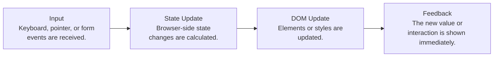

# Bubble Sort Visualiser

Provides a browser-based visualization of bubble sort, including step-by-step state changes.

## Overview

The repository contains an implemented application or analysis project with code organized around its primary runtime, interface, data, or automation responsibilities.

## Key Features

- Self-contained implementation
- Browser or tool-based interaction
- Reusable project structure
- Clear input-to-output workflow

## Technology Stack

| Area | Technology |
|---|---|
| Library / Framework / Tool | HTML |
| Library / Framework / Tool | CSS |
| Library / Framework / Tool | JavaScript |

## Architecture and Data Flow

| Stage | Responsibility |
|---|---|
| **Input** | Keyboard, pointer, or form events are received. |
| **State Update** | Browser-side state changes are calculated. |
| **DOM Update** | Elements or styles are updated. |
| **Feedback** | The new value or interaction is shown immediately. |

## Repository Structure

- `index.html`
- `index.js`
- `style.css`

## Setup

1. Review the repository structure and applicable runtime requirement.
2. Open the entry-point file in an editor or IDE.
3. Run or open it using the tool required for the project language.

## Usage

Open the application entry point in the browser or run it with the project platform tools. Interact through the available controls and observe the rendered state.

## Configuration

No mandatory repository-specific configuration is documented by the project structure. Environment or runtime options may be defined inside the relevant entry-point file or platform settings.

## Verification

- Run the project entry point and verify the primary success and error paths.
